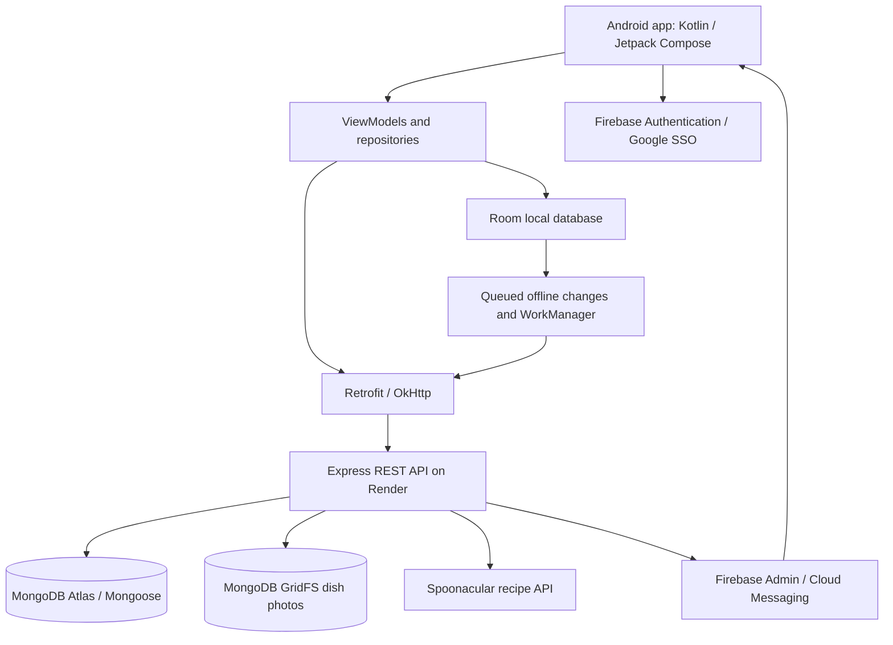

# KitchenQuest

**Cook smarter. Waste less. Love it.**

KitchenQuest is a native Android cooking and kitchen-management app created for **PROG7314, Group 13**. It helps users keep track of the ingredients they own, find recipes that use those ingredients, plan shopping and follow recipes while cooking. Instead of treating the pantry, shopping list and cooking history as separate jobs, KitchenQuest connects them into one workflow.

The project progressed from competitor research and a Figma design in **Part 1**, to a working Android/REST API prototype in **Part 2**, and then to offline synchronization, biometrics, bilingual support, push notifications, persistent timers and dish photos for the **Final POE**.

**Project links and submission evidence**

- **Source code:** [KitchenQuest on GitHub](https://github.com/ST10321249/PROG7314_KitchenQuest)
- **Full development history:** [Release notes](RELEASE_NOTES.md), covering Parts 1–3
- **Backend routes and configuration:** [Backend README](backend/README.md)
- **GitHub Actions:** [Android and backend CI runs](https://github.com/ST10321249/PROG7314_KitchenQuest/actions)
- **Final physical-device demonstration:** **[Add the unlisted video link here after uploading it]**
- **Signed production APK:** **[Add the final GitHub release link after building, signing and attaching the APK]**
- **Final release tag:** `Final-POE` **(create and push after the final commit passes verification)**

> **Submission note:** The last three entries are evidence to be supplied before submission, not claims that a signed APK, video or final tag has already been published. The repository's normal build output is not a substitute for a signed release artifact.

## Screenshots and app walkthrough

The screenshots below should come from the **final app running on a physical Android phone**, not the original Figma mockups. Replace each bracketed line with a real GitHub Markdown image reference after taking your screenshots (for example, ``). Keep private email addresses and tokens out of screenshots.

### 1. Welcome and account security

[placeholder image for the KitchenQuest splash screen]

[placeholder image for the login and Google sign-in screen]

[placeholder image for the biometric quick unlock screen]

Users can create an account, sign in with email/password or Google, reset a password and configure biometric quick unlock. Biometric authentication protects an existing Firebase session; it does not replace initial account sign-in. The onboarding flow saves dietary preferences and ingredients to avoid.

### 2. Home and My Kitchen

[placeholder image for the Home dashboard showing pantry counts and expiring ingredients]

[placeholder image for the My Kitchen ingredient list and expiry warnings]

[placeholder image for the add or edit ingredient screen]

Home provides shortcuts to recipes, timers, shopping and ingredient-based discovery. My Kitchen stores ingredient names, quantities, units, categories and optional expiry dates. Users can add, edit, search and remove ingredients. Items near expiry are highlighted, with reminders controlled from Settings.

### 3. Recipes and shopping

[placeholder image for recipe search and recipe categories]

[placeholder image for What Can I Make showing ingredient matches and missing ingredients]

[placeholder image for recipe details with serving-size adjustments]

[placeholder image for the Shopping List]

Recipes are retrieved through our hosted API, which queries Spoonacular. **What Can I Make?** compares recipes against pantry ingredients and shows the match ratio and missing ingredients. Recipe details support serving-size changes. Missing ingredients can be added to the shopping list, and purchased items can be transferred into the pantry.

### 4. Cooking and personal records

[placeholder image for Cooking Mode with a recipe step and timer]

[placeholder image for the Active Timers or Kitchen Timer screen]

[placeholder image for recipe completion with a dish photo]

[placeholder image for Cooking History showing ratings and a saved dish photo]

Cooking Mode displays steps one at a time. Recipe timers and the standalone kitchen timer share a timer system, with alarms for completed timers. The app stores cooking progress locally so it can be restored. Completed dishes can be recorded with a rating, difficulty feedback, note and an optional photograph.

### 5. Final POE evidence screens

[placeholder image for offline pantry changes waiting to sync]

[placeholder image for the same items after reconnecting and successful synchronization]

[placeholder image for Settings in Afrikaans]

[placeholder image for the Firebase Cloud Messaging test notification received on the device]

[placeholder image for the Notifications screen and notification preferences]

These last screenshots support the POE-specific requirements. The demonstration video must also show the changes reflected in the actual backend database, not merely the Android interface.

## Key features

| Feature | What it does |
| --- | --- |
| Account authentication | Firebase email/password and Google SSO; optional biometric unlock for returning sessions |
| Preferences | Dietary choices, avoided ingredients, English/Afrikaans, notification and security options |
| Pantry management | Add, edit, delete and search ingredients; track quantities, categories and expiry dates |
| Recipe discovery | Search recipes through the hosted API and Spoonacular; filter and adjust servings |
| What Can I Make? | Rank available recipes by matching pantry ingredients and show missing items |
| Connected shopping | Add items manually or from recipes; move purchased items to the pantry |
| Offline pantry and shopping | Local Room storage, queued changes, automatic WorkManager sync and sync-status feedback |
| Offline recipe reading | Keep copies of previously opened recipes and saved favourites for use without connectivity |
| Cooking Mode | Guided recipe steps, locally restored progress and shared kitchen/recipe timers |
| Notifications | Remote Firebase Cloud Messaging, local expiry reminders and cooking timer alarms |
| Cooking history | Save completed recipes, optional rating/difficulty/notes and a finished-dish photograph |
| File storage | Store and retrieve finished-dish photos through protected MongoDB GridFS endpoints |
| Language support | Localized English/Afrikaans app interface; Google ML Kit language-model and translation service |

**Language scope:** The static Android interface uses English and Afrikaans resources. Google ML Kit supplies on-device translation capabilities, including downloadable models. Machine translation of every Spoonacular response and every user-entered field is **not automatically wired into all recipe/pantry screens**, so original API text can still appear. This is not a third-party cloud translation service.

## Architecture



**Android:** Kotlin, Jetpack Compose, MVVM, RoomDB, WorkManager, Retrofit/OkHttp, Kotlin serialization, Firebase Auth, AndroidX Biometric, Firebase Cloud Messaging and Google ML Kit Translate.

**Backend:** Node.js 22+, Express, MongoDB Atlas/Mongoose, Firebase Admin, Zod validation, Spoonacular and GridFS.

**Hosting:** Render for the custom REST API. The API keeps Spoonacular credentials server-side rather than embedding them in the Android client.

### Offline synchronization flow

1. The signed-in user opens their pantry or shopping list. The app reads locally cached records from Room.
2. An offline edit is saved locally and placed into an account-scoped pending-operation queue.
3. The interface shows the operation's pending or failed state.
4. WorkManager retries queued operations when connectivity is available; the API uses client-generated identifiers and idempotent handling to reduce duplicate writes.
5. Successful responses reconcile local records with the server. Each account's records and pending operations are kept separate.

**Offline scope is deliberate:** pantry and shopping support offline actions; previously cached recipes can be read offline. **Searching for new recipes and fetching new Spoonacular recommendations still require internet access.**

### Authentication and data protection

Firebase Authentication handles credentials and Google SSO. The Android client attaches Firebase ID tokens to protected requests; the Express backend verifies them with Firebase Admin and scopes application records to the authenticated UID. Photos have protected upload/download routes with ownership and file-validation checks. Biometric verification uses the device's biometric APIs; KitchenQuest does not store fingerprints or face images.

## API overview

The API responds publicly at `GET /health`. Other application routes require a valid Firebase ID token.

| Area | Main endpoints |
| --- | --- |
| Account | `/api/users/sync`, `/api/users/me` |
| Pantry | `/api/pantry` and item routes |
| Shopping | `/api/shopping-list` and item routes |
| Recipe discovery | `/api/recipes/search`, `/api/recipes/:id`, `/api/recipes/recommendations` |
| Favourites | `/api/favourites` |
| History and notes | `/api/history`, `/api/recipe-notes` |
| Push devices and test | `/api/devices`, `/api/notifications/test` |
| Photo storage | `/api/files` and file-ID routes |

See [`backend/README.md`](backend/README.md) for method-by-method information and payloads.

## Project structure

```text
.github/workflows/android-ci.yml    Android and backend verification
KitchenQuest/                       Native Android project
  app/src/main/java/                UI, navigation, ViewModels and repositories
  app/src/main/res/                 English/Afrikaans strings, icons, visual assets
  app/src/test/                     Android unit tests
  app/schemas/                      Room migration schemas
backend/                            Express API, models, validation and tests
README.md                           Technical overview and screenshot evidence
RELEASE_NOTES.md                    Research, prototype and POE release history
```

## Build and run

### Android requirements

- Android Studio with the installed Android SDK matching `compileSdk` in `app/build.gradle.kts`
- JDK 21 for the Gradle tooling used by CI
- Android 8.0 (API 26) or newer, ideally a **physical Android phone** for the final demo
- Your own configured Firebase Android application (`KitchenQuest/app/google-services.json`)

From the `KitchenQuest` directory:

**Windows PowerShell**

```powershell
.\gradlew.bat testDebugUnitTest
.\gradlew.bat assembleDebug
```

**macOS/Linux**

```bash
./gradlew testDebugUnitTest
./gradlew assembleDebug
```

Android's debug APK is for development. A debug APK is **not** evidence of a signed production APK.

### Hosted or local API

The Android build uses `https://prog7314-kitchenquest-g7bd.onrender.com/` by default. To run your own backend, create `backend/.env` from `backend/.env.example` and provide `MONGODB_URI`, `FIREBASE_SERVICE_ACCOUNT_PATH` and `SPOONACULAR_API_KEY` privately.

```powershell
cd backend
npm ci
npm test
npm start
```

To redirect the Android app to your local API, add `api.baseUrl=http://localhost:5000` to `KitchenQuest/local.properties` and rebuild. For a USB-connected physical phone, use `adb reverse tcp:5000 tcp:5000`. Do not put service-account JSON, MongoDB credentials, API keys or signing passwords in the repository.

### Build the production APK

The Android configuration supports a release key supplied privately using `KitchenQuest/keystore.properties` or the `KQ_KEYSTORE_FILE`, `KQ_KEYSTORE_PASSWORD`, `KQ_KEY_ALIAS` and `KQ_KEY_PASSWORD` environment variables. Generate and securely store a real release keystore before building. From the `KitchenQuest` directory:

```powershell
.\gradlew.bat assembleRelease
```

**A successful release Gradle task does not, on its own, prove that the APK was signed.** Verify the release signature with Android's `apksigner verify --verbose --print-certs <path-to-apk>` and install the APK on a physical phone. Publish the verified artifact separately in the GitHub release; do not commit APKs, keystores or ZIPs to the source repository. The configured project version is **2.0.0 (version code 2)**.

## Tests, GitHub and CI

The project contains Android tests for authentication, ViewModels, database migrations, offline queues/synchronization, account separation, recipe caching, timer state, notifications and photo handling. Backend Jest tests cover authentication, route behavior, validation, device tokens, idempotency and protected file access.

The tracked [GitHub Actions workflow](.github/workflows/android-ci.yml) runs on pushes and pull requests. It builds/tests Android with Java 21 and runs backend tests with Node.js 22. Four main implementation branches were used: `authentication`, `api-data-layer`, `pantry-shopping` and `recipes-cooking`. See the [commit history](https://github.com/ST10321249/PROG7314_KitchenQuest/commits/main/) for the group's actual work.

The final submission must have a successful run **on the submitted commit** and the annotated `Final-POE` tag placed on that verified commit. Previous successful workflow runs do not verify later edits automatically.

## Development history and design origins

- **Part 1, research and planning:** Competitor analysis of SuperCook, Kitchen Stories and KitchenPal. This influenced ingredient-first recipe matching, expiry-aware pantry management, connected shopping and guided cooking. The team produced UI mockups, UML, data models and a REST API specification.
- **Part 2, prototype:** Implemented Firebase account/Google login, onboarding, initial Settings, custom Node/Express backend with MongoDB, pantry and shopping CRUD, recipe search and details, favourites, guided cooking, history, shared styling, navigation and tests.
- **Final POE, version 2.0.0:** Added biometric unlock, English/Afrikaans localization, Room-backed offline actions and synchronization, on-device recipe caching, FCM push, expiry alerts, persistent timer alarms, GridFS dish photos, app icon and release/CI preparation.

The complete change history, including new features, refinements and known limitations, is in **[RELEASE_NOTES.md](RELEASE_NOTES.md)**.

### Design requirements and current scope

The Part 1 blueprint defined 12 functional requirements (FR-01 to FR-12) and three custom requirements (CR-01 to CR-03). The final implementation covers the core POE requirements in code, but some **expanded Part 1 ideas are only partial**: full difficulty/meal-type/cuisine filters, every proposed expiry-driven recipe suggestion, optional voice/barcode ingredient capture and comprehensive automatic translation of live recipe text are not all present. The release notes distinguish these from completed features rather than listing design goals as finished functionality.

## Final physical-device demonstration

Show a working install and the actual app on a physical phone, with an explanatory voice-over:

1. Register/sign in with Google SSO or email; enable biometric unlock, leave and return to the app.
2. Change Settings and switch English ⇄ Afrikaans.
3. Add and edit a pantry item online and show its matching record in MongoDB.
4. Turn on airplane mode; change pantry and shopping data; close/reopen; reconnect and confirm the pending changes reach MongoDB.
5. Send a genuine FCM test push to the phone; show a timer finishing while KitchenQuest is backgrounded.
6. Find a recipe, adjust servings, complete a cook, attach a photo and retrieve it from Cooking History/GridFS.
7. Show the installed **signed release** APK, final app icon, promotional screenshots, final successful CI run and `Final-POE` tag.

## Known limitations and final evidence to supply

- New recipe searches and live recommendations need Spoonacular and a working internet connection. Render cold starts can add latency.
- Recipe artwork in the current UI is mostly icon-based; user-provided dish photos are stored in GridFS.
- Google ML Kit's translation service/model download exists, but it is not automatically applied to all API or user-entered recipe text.
- Some advanced Part 1 filters and optional voice/barcode ideas are not implemented.
- Screenshot placeholders above must be replaced with actual captures, and the demonstration video and verified signed APK must be linked before submission.
- Verify biometric behavior after an uninstall/reinstall and account switching on real devices; Android backup configuration matters.

## Team and acknowledgements

Final POE implementation branches: **Raheel Singh** (authentication), **Akeev Sivai** (API/data layer), **Avikar Maharaj** (pantry/shopping) and **Mohamed Shaheer Joosab** (recipes/cooking). The original Part 1 research document also credits **Kaeden Samsunder** for that phase.

## References

- Android Developers. *Biometric authentication*. https://developer.android.com/identity/sign-in/biometric-auth
- Android Developers. *Room database*. https://developer.android.com/training/data-storage/room
- Android Developers. *WorkManager*. https://developer.android.com/develop/background-work/background-tasks/persistent
- Android Developers. *Alarms*. https://developer.android.com/develop/background-work/services/alarms/schedule
- Firebase. *Authentication*. https://firebase.google.com/docs/auth
- Firebase. *Cloud Messaging*. https://firebase.google.com/docs/cloud-messaging
- Google ML Kit. *Translate text on Android*. https://developers.google.com/ml-kit/language/translation/android
- MongoDB. *GridFS*. https://www.mongodb.com/docs/manual/core/gridfs/
- Spoonacular. *Food API*. https://spoonacular.com/food-api
