# KitchenQuest

KitchenQuest is an Android cooking app we built for PROG7314 (Group 13). You keep track of what is in your kitchen, the app shows you recipes you can make with it, tells you what you are missing, and then helps you cook the meal. We wanted the pantry, shopping list, recipes and cooking to work together instead of being separate apps, and to cut down on food going to waste because people forget what they have.

Links:

- [Demo video](https://youtu.be/TLxaVVVlTd8)
- [Download the signed APK (v2.0.0)](https://github.com/ST10321249/PROG7314_KitchenQuest/releases/download/Final-POE/app-release.apk)
- [Final POE release](https://github.com/ST10321249/PROG7314_KitchenQuest/releases/tag/Final-POE)
- [Release notes](RELEASE_NOTES.md)
- [Backend README](backend/README.md)
- [GitHub Actions runs](https://github.com/ST10321249/PROG7314_KitchenQuest/actions)

## The team

- Raheel Singh - authentication, biometrics and languages
- Akeev Sivai - API, data layer, offline sync, push server and photo storage
- Avikar Maharaj - pantry, shopping list and expiry reminders
- Mohamed Shaheer Joosab - recipes, cooking, timers, photos and release

Kaeden Samsunder also worked with us on the Part 1 research.

## What we planned in Part 1

Part 1 was research and design only, so there was no working app yet. We looked at three existing apps and took ideas from each:

- SuperCook gave us the idea of searching recipes by what is in your pantry, and of linking missing ingredients to a shopping list.
- Kitchen Stories gave us full recipe pages, adjustable servings and step-by-step cooking with timers.
- KitchenPal gave us ingredient quantities, categories, expiry tracking and reminders.

None of them really kept a personal record of what you cooked, so we added saved recipes, ratings, notes and a cooking history to our plan.

From that research we made the concept and logo, the Figma screens and navigation flow, UML and data models, a REST API plan and a project timeline. We also wrote 12 functional requirements (FR-01 to FR-12) and three custom requirements (CR-01 to CR-03). The plan was a Kotlin and Jetpack Compose app with Firebase sign-in, a hosted API, MongoDB, a recipe API, offline storage with Room, notifications and two languages. We also talked about voice input and barcode scanning as possible extras.

## What we built in Part 2

Part 2 was the first working version of the app and backend:

- Register, log in, reset your password and sign in with Google using Firebase
- Onboarding for dietary preferences and ingredients to avoid, plus a Settings screen
- Five main tabs: Home, Recipes, My Kitchen, Cook and Profile
- A Node.js and Express API hosted on Render, with MongoDB Atlas as the database
- Spoonacular for recipes, called through our API so the key stays off the phone
- My Kitchen with quantities, units, categories and expiry dates
- A shopping list you can move bought items from into your pantry
- Recipe search, recipe details, changing servings and saved recipes
- What Can I Make?, which compares recipes to your pantry and lists what is missing
- Guided cooking with timers, a recipe complete screen and cooking history
- The orange and cream design from Part 1, Android and backend tests, and GitHub Actions

At this stage the app still needed the internet for everything. It had no biometrics, no real push notifications, no second language and no photo storage.

## What we added for the Final POE

- Biometric unlock (fingerprint or face) for returning users, with normal login as a fallback
- English and Afrikaans for the whole app, chosen in Settings and saved to your profile
- Google ML Kit translation with downloadable language models
- Offline pantry and shopping list using Room, with changes queued and sent by WorkManager when you reconnect
- Sync status on items so you can see what is waiting and what failed
- Firebase Cloud Messaging push notifications
- Local expiry reminders that can be turned on or off per account
- Timer alarms that still go off when the app is in the background
- Our two user-defined features, explained below
- A new app icon, a signed release APK and CI switched back on

## Features

- Accounts: email and password, Google sign-in, password reset and optional biometric unlock
- Preferences: dietary choices, ingredients to avoid, language, reminders and security options
- My Kitchen: add, edit, delete and search ingredients, with categories and expiry warnings
- Recipes: search, view details, change servings and save favourites
- What Can I Make?: recipes ranked by how many of the ingredients you already have
- Shopping list: add items yourself or from a recipe, then move them into your pantry
- Offline: pantry and shopping changes work without internet and sync later
- Cooking mode: step-by-step instructions and timers, and you can carry on where you left off
- Notifications: push notifications, expiry reminders and timer alarms
- Cooking history: ratings, difficulty, private notes and a photo of the finished dish
- Profile: your cooking stats, with links to saved recipes and history

## Our two user-defined features

1. Offline recipes and resumable cooking. Recipes you have opened or saved are stored on the phone, so you can read them and cook from them with no internet. The current step and any running timers also survive the app being closed. Searching for new recipes still needs internet.
2. Finished-dish photos. When you finish a recipe you can add a photo with your rating and notes. The app shrinks the photo, uploads it through the API to MongoDB GridFS, and you can view it later in Cooking History. Only the person who uploaded a photo can see it.

## Screenshots

These were taken from the app running on an Android phone.

Login, create account and dietary preferences:

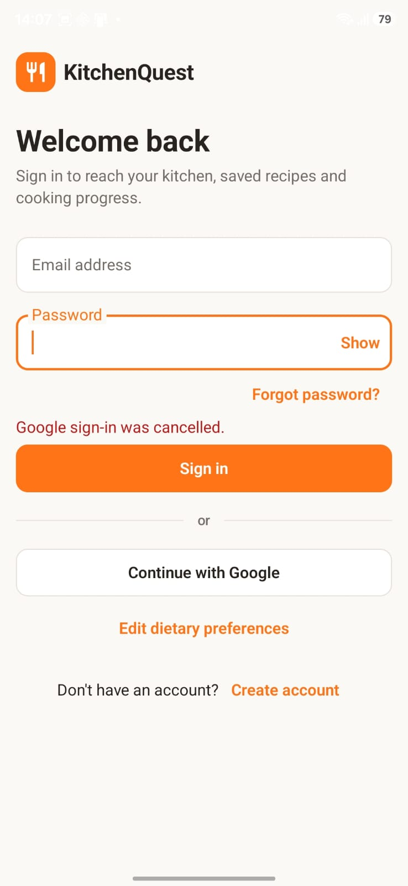 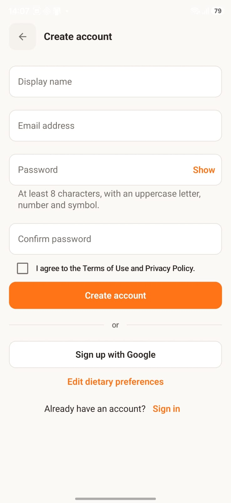 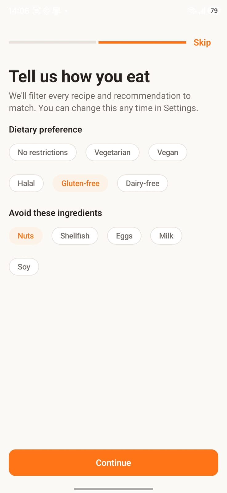

Home and My Kitchen:

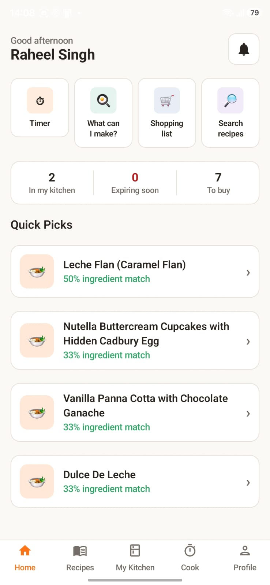 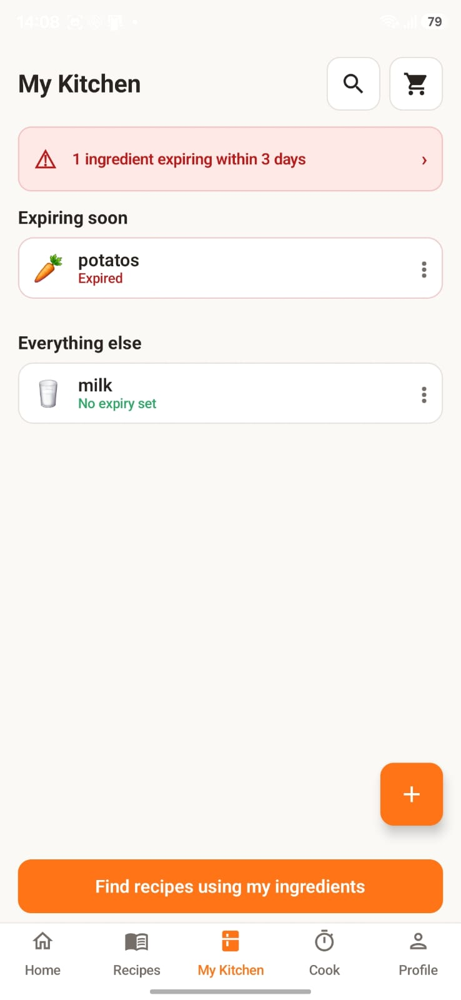

Recipes, recipe details and saved recipes:

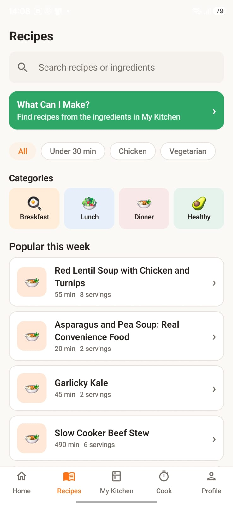 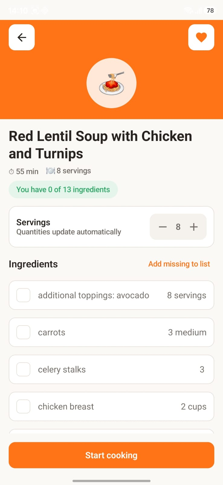 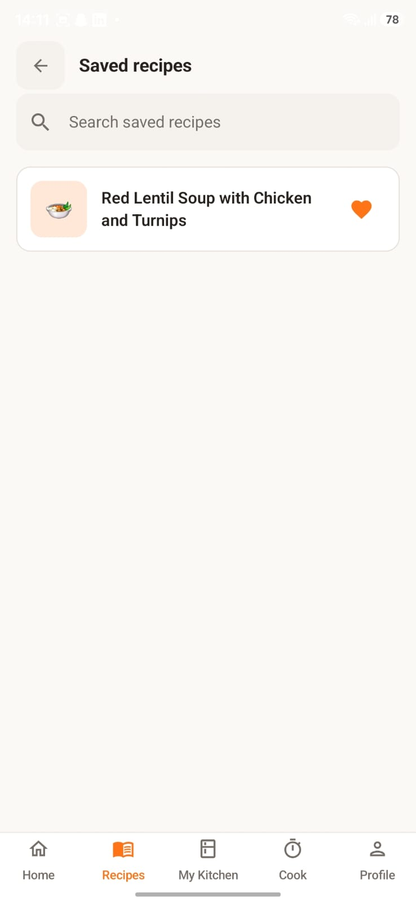

Shopping list:

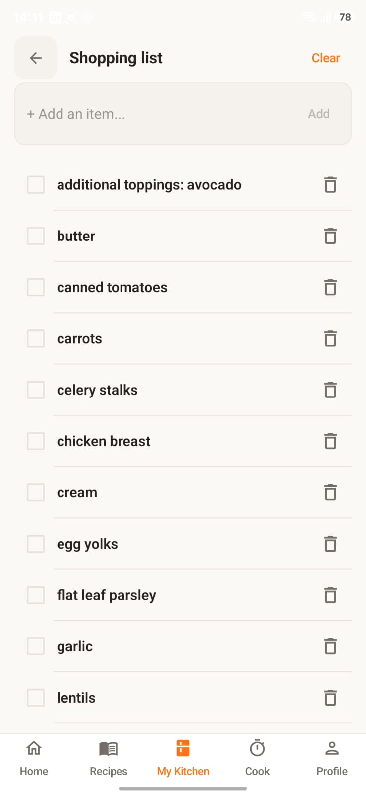

Cook screen, cooking steps and kitchen timer:

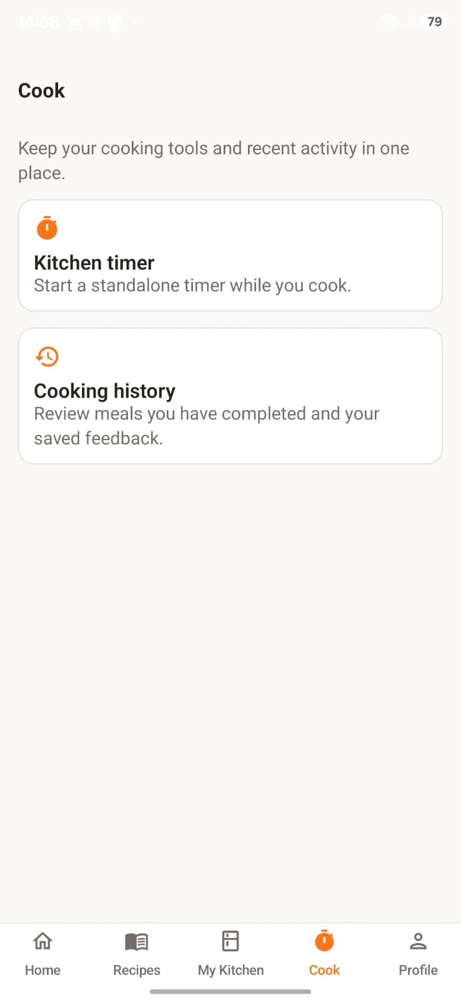 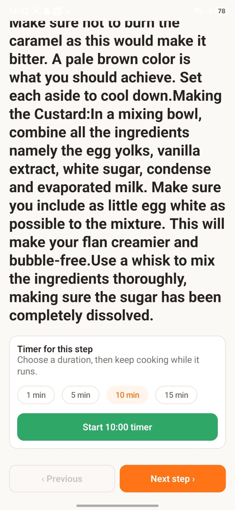 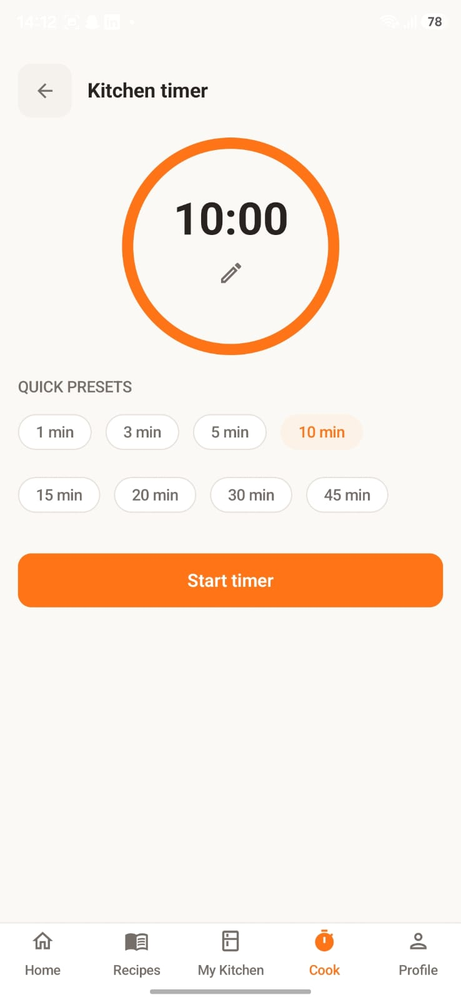

Recipe complete and cooking history:

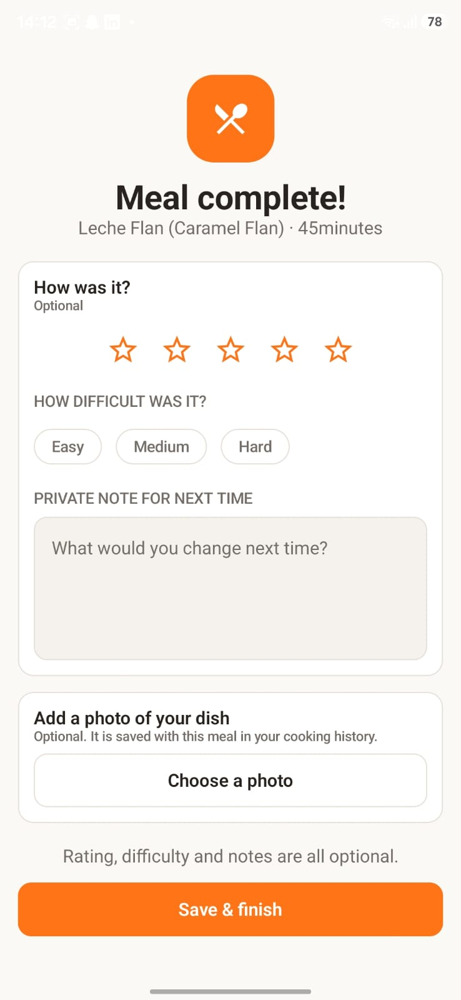 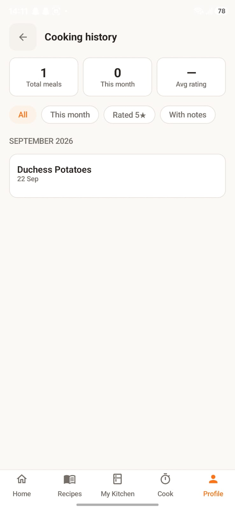

Profile and Settings:

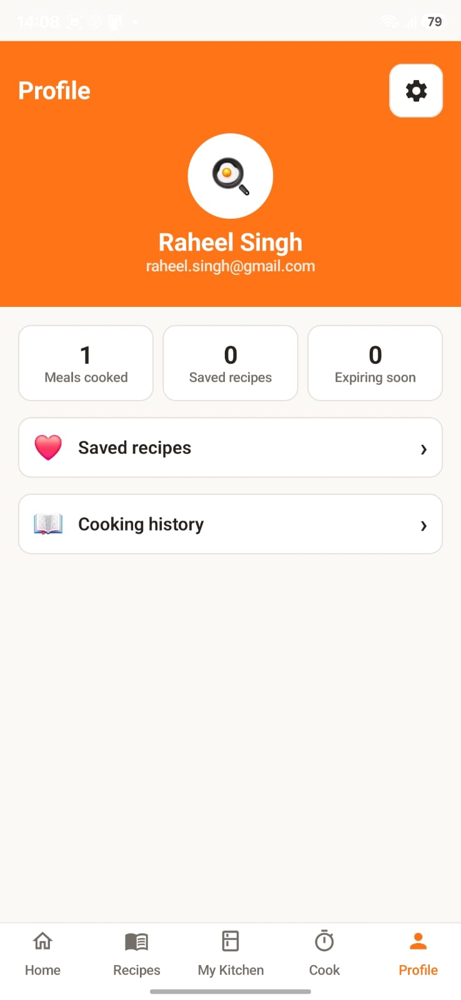 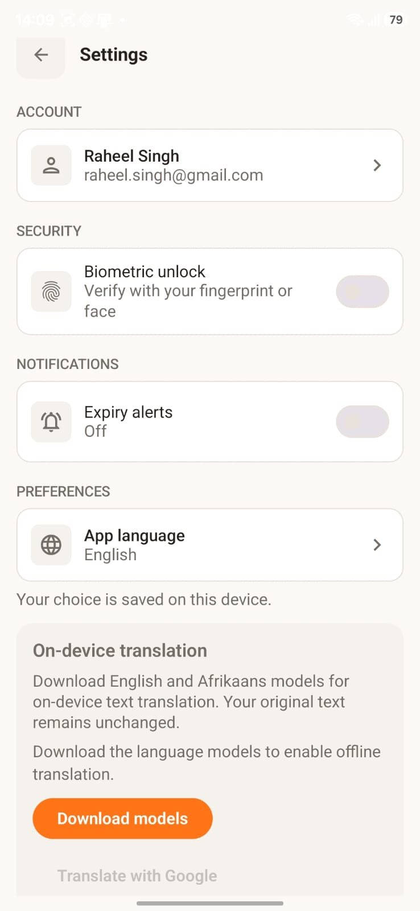 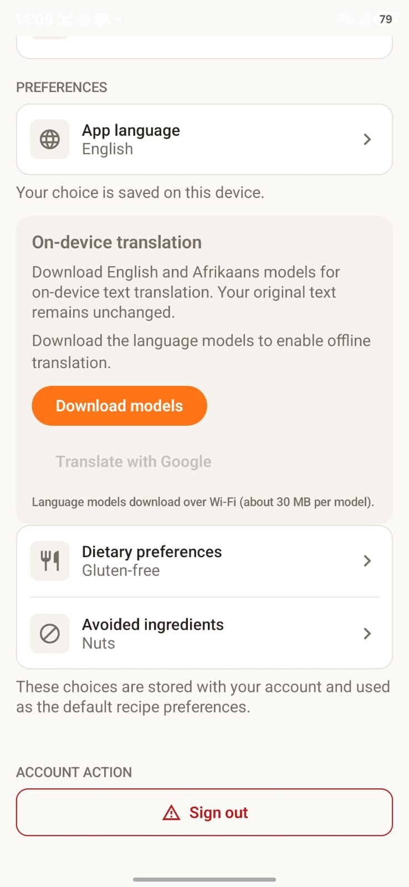

Choosing a language, then Settings and Home in Afrikaans:

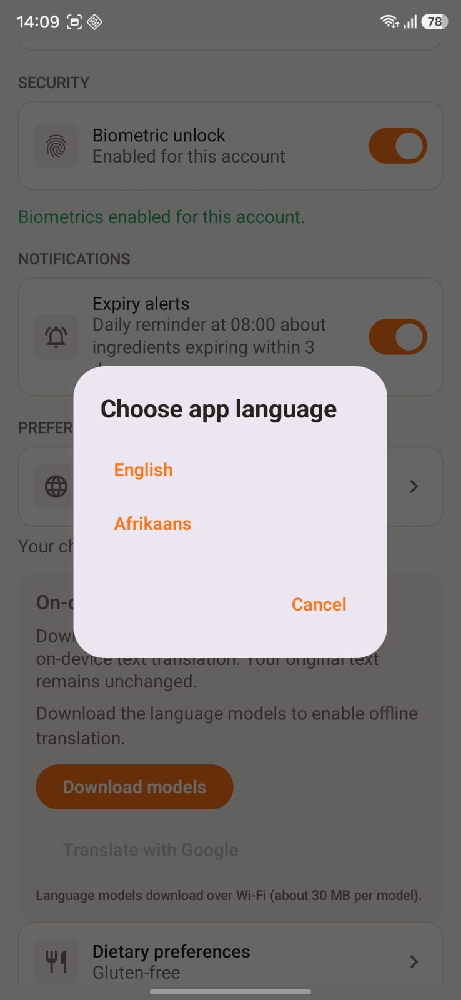 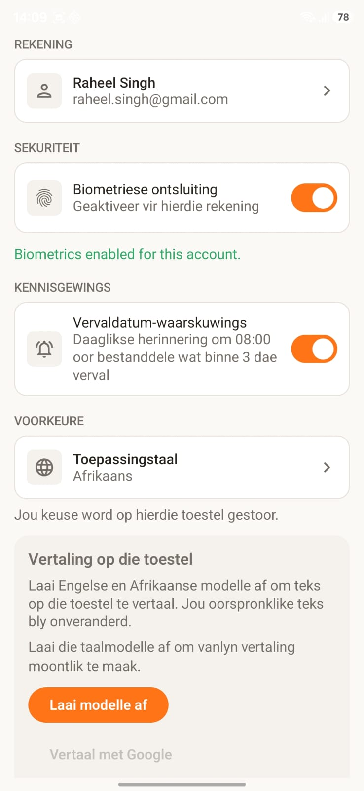 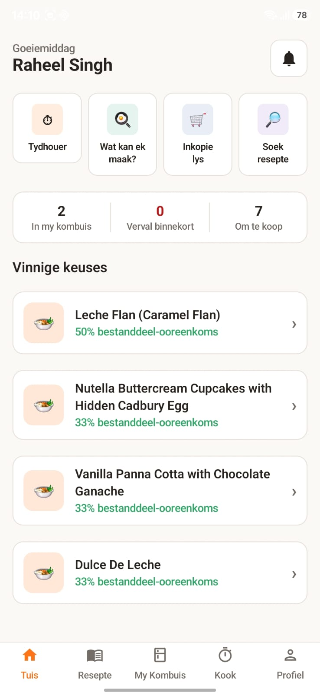

Notifications screen and a push notification on the phone:

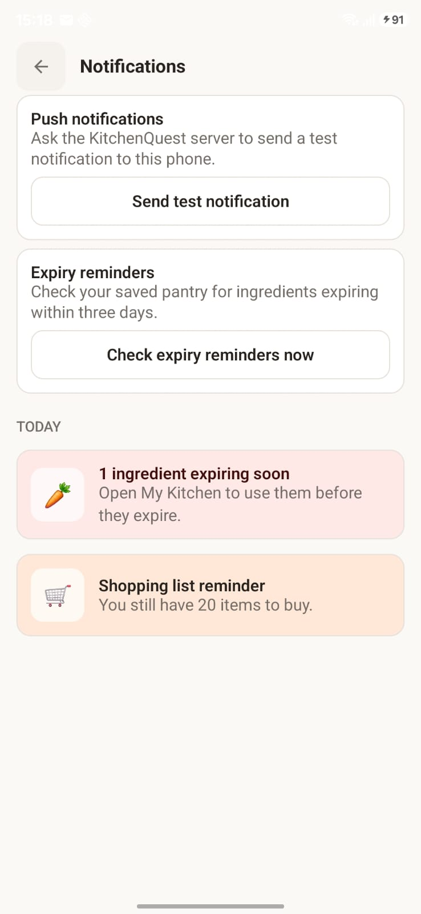 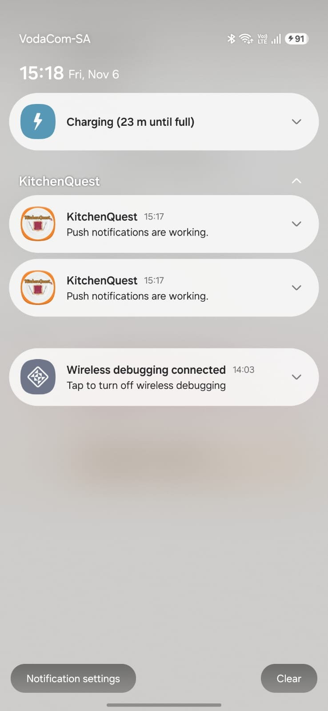

Biometric unlock, offline sync and the cloud database updating are easier to see in the [demo video](https://youtu.be/TLxaVVVlTd8).

## How it works

The app is written in Kotlin with Jetpack Compose and follows MVVM with repositories. The backend is Node.js and Express. This is roughly how everything connects:

```text
Screens -> ViewModels -> Repositories
Repositories -> Room (data saved on the phone)
Repositories -> Retrofit -> Express API on Render
Express API -> MongoDB Atlas (users, pantry, shopping, history)
Express API -> MongoDB GridFS (dish photos)
Express API -> Spoonacular (recipes)
Express API -> Firebase Cloud Messaging -> push notifications
Firebase Auth -> ID token -> Express API checks it on every request
WorkManager -> sends queued changes and runs expiry reminders
AlarmManager -> cooking timer alarms
```

How offline works for the pantry and shopping list:

1. You make a change. It saves on the phone straight away and goes into a queue.
2. The item shows as waiting to sync.
3. When there is a connection, WorkManager sends the queue in order and retries if something fails.
4. Each item has an id made on the phone, so if a request gets sent twice the server does not create a duplicate.
5. Every item and queued change is linked to the signed-in account, so two accounts on one phone never see each other's data.

Security: the app sends a Firebase token with every request and the backend checks it before doing anything. Each user can only reach their own data. API keys stay on the server. Biometric unlock uses the phone's own system, so we never store fingerprints or face data.

## API

`GET /health` is public. Everything else needs a Firebase token. The main routes are:

- `/api/users` - sync the account, get and update the profile
- `/api/pantry` - pantry items
- `/api/shopping-list` - shopping items, and `/transfer` to move an item to the pantry
- `/api/recipes` - `/search`, `/recommendations` and `/:id`
- `/api/favourites` - saved recipes
- `/api/history` - cooking history
- `/api/recipe-notes` - private recipe notes
- `/api/devices` - register or remove a phone for push notifications
- `/api/notifications/test` - send a test push to your own phone
- `/api/files` - upload, view and delete dish photos (JPEG, PNG or WebP, up to 3 MB, 50 per user)

The [backend README](backend/README.md) has more detail on the routes from Part 2.

## Folder layout

```text
KitchenQuest/ -> the Android project
  app/src/main/java/ -> screens, ViewModels, repositories, database and sync
  app/src/main/res/ -> English and Afrikaans strings, icons and images
  app/src/test/ -> Android unit tests
  app/schemas/ -> Room database schemas
backend/ -> the Express API, models, validation and tests
docs/screenshots/ -> the screenshots in this README
.github/workflows/ -> GitHub Actions
RELEASE_NOTES.md -> what changed in each part
```

## How to run it

### Just try the app

Download the [signed APK](https://github.com/ST10321249/PROG7314_KitchenQuest/releases/download/Final-POE/app-release.apk) on an Android phone (Android 8.0 or newer) and install it. You may need to allow installs from unknown sources. It already points to our hosted API, so you do not need to run anything else. The hosted API is on Render's free plan, so the first request can take about a minute while the server wakes up.

### Run the Android project

You need Android Studio, the Android SDK for API 37 and JDK 21. A physical phone is best, because biometrics and push notifications need one.

1. Clone the repo: `git clone https://github.com/ST10321249/PROG7314_KitchenQuest.git`
2. Open the `KitchenQuest` folder in Android Studio and let Gradle sync.
3. Press Run with your phone or an emulator selected.

The Firebase app config (`google-services.json`) is already in the project and the app uses the hosted API by default, so you do not need to set anything up to run it.

You can also build from the `KitchenQuest` folder in a terminal:

```powershell
.\gradlew.bat testDebugUnitTest
.\gradlew.bat assembleDebug
```

On Mac or Linux use `./gradlew` instead of `.\gradlew.bat`.

### Run the backend yourself

You only need this if you do not want to use the hosted API. You need Node.js 22 or newer, a MongoDB Atlas database, a Firebase service account key from the same Firebase project as the app, and a Spoonacular API key.

1. Go into the `backend` folder and copy `.env.example` to `.env`.
2. Fill in `MONGODB_URI`, `FIREBASE_SERVICE_ACCOUNT_PATH` and `SPOONACULAR_API_KEY`.
3. Put your service account key file in the `backend` folder.
4. Install and start it:

```powershell
cd backend
npm ci
npm start
```

The API runs on port 5000. Check it by opening `http://localhost:5000/health`.

To point the app at your own backend, add one line to `KitchenQuest/local.properties` and rebuild:

```text
api.baseUrl=http://localhost:5000
```

For a phone connected by USB, also run `adb reverse tcp:5000 tcp:5000`. For the emulator, use `http://10.0.2.2:5000` as the address instead. Plain HTTP only works in debug builds.

Never commit your `.env`, service account key, `local.properties`, keystore or passwords.

### Build a signed APK

Use Build > Generate Signed Bundle / APK > APK > release in Android Studio with your own keystore. You can also put your signing details in `KitchenQuest/keystore.properties` (or the `KQ_KEYSTORE_FILE`, `KQ_KEYSTORE_PASSWORD`, `KQ_KEY_ALIAS` and `KQ_KEY_PASSWORD` environment variables) and run `.\gradlew.bat assembleRelease`. The app version is 2.0.0 (version code 2).

## Tests

- Android: 393 unit tests, run with `.\gradlew.bat testDebugUnitTest` from the `KitchenQuest` folder. They cover login rules, ViewModels, the Room database and migrations, offline sync, account separation, recipe caching, timers, notifications and photos.
- Backend: 210 Jest tests, run with `npm test` from the `backend` folder. They cover sign-in checks on every route, validation, duplicate requests, device tokens and photo access.

GitHub Actions runs both on every push and pull request, using Java 21 and Node.js 22. We worked on four branches: `authentication`, `api-data-layer`, `pantry-shopping` and `recipes-cooking`.

## Known limitations

- Searching for new recipes and getting new recommendations needs internet.
- The hosted API can be slow on the first request because of Render's free plan.
- Only recipes you have already opened or saved work offline.
- The app screens are translated into Afrikaans, but recipe text from Spoonacular and anything users type can stay in its original language. The ML Kit translation service is in the app but is not applied everywhere.
- Most recipe images in the app are icons. Only your own dish photos are real pictures.
- Notifications and alarms depend on the permissions and battery settings on the phone.

## References

- Android Developers. Biometric authentication. https://developer.android.com/identity/sign-in/biometric-auth
- Android Developers. Room database. https://developer.android.com/training/data-storage/room
- Android Developers. WorkManager. https://developer.android.com/develop/background-work/background-tasks/persistent
- Android Developers. Alarms. https://developer.android.com/develop/background-work/services/alarms/schedule
- Firebase. Authentication. https://firebase.google.com/docs/auth
- Firebase. Cloud Messaging. https://firebase.google.com/docs/cloud-messaging
- Google ML Kit. Translate text on Android. https://developers.google.com/ml-kit/language/translation/android
- MongoDB. GridFS. https://www.mongodb.com/docs/manual/core/gridfs/
- Spoonacular. Food API. https://spoonacular.com/food-api
